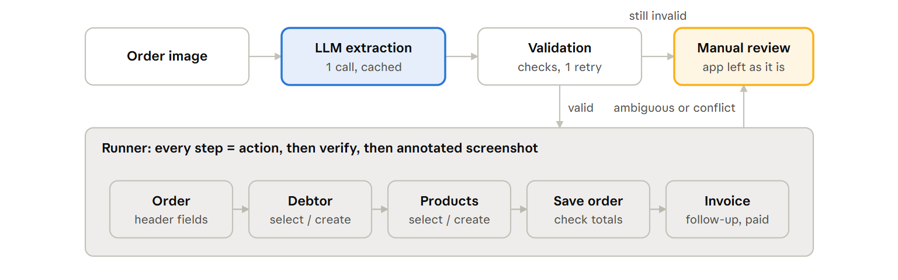

# Fakturama Image-to-Cash: Design

## 1. Overview

**Goal.** Turn one order image into a saved **Order** and a linked **Invoice**, created through the Order's *Create a follow-up document › Invoice*, with the payment status set. Every step is verified; anything ambiguous stops the run for manual review and leaves Fakturama as it is.

**Approach.** One LLM call turns the image into validated data. Everything after that is deterministic Python driving Fakturama through Microsoft UI Automation (UIA). Windows OCR is used only where UIA is blind (NatTable tables, tab labels), always inside a rectangle UIA provided. No coordinates are hardcoded.

**Validated in a prototype:** end to end `status: ok` in 132.5 s creating all master data and 64.1 s selecting it on the next run, all create paths verified live, 137 offline tests.

## 2. Image-extraction strategy

- **One vision call** (Claude Haiku by default, Gemini free tier as fallback) returns JSON through a forced tool call with a flat schema, so nothing is parsed from free text. Unlike an OCR template parser, it copes with layout changes.
- **Typed model:** Pydantic `OrderData`, money as `Decimal` rounded half-up to 2 places.
- **Deterministic validation; the LLM is never trusted:** line net = qty × price × (1 − discount), Σ lines = net, VAT and gross consistent (±0.01 per line), percentages 0–100, required fields present, PAID ⇒ payment date.
- **One retry** with the failed checks, asking to re-transcribe rather than adjust numbers. Still invalid → manual review, before Fakturama is touched.
- **Cache** keyed by image hash, provider, model and prompt version, so re-runs cost no tokens.

Matching, navigation and verification never use the LLM, so runs are reproducible.

## 3. Control-discovery & grounding strategy

**Probe first.** Before a screen is coded, a probe tool dumps its UIA tree and a screenshot. Selectors are built from the dumps (replayed in offline tests), and label strings live in `config/settings.yaml`.

**Order of preference, never coordinates:**

1. **UIA type + name.** SWT names inputs after their label and toolbar buttons after their tooltip.
2. **UIA label geometry.** The nearest input right of or below a `Text` label, for unnamed fields, two-column forms and "ZIP - City".
3. **UIA structure.** The upper unnamed `Image` under a label is "select existing" (never the green +); a table is the largest pane holding only scrollbars.
4. **OCR inside a UIA rectangle.** Table cells, rows and tab labels; clicks go to an OCR word box found in this run. Per-monitor DPI awareness keeps UIA, screenshots and mouse in one pixel space.

**NatTable tables are opaque to UIA.** OCR words are grouped into rows, columns come from the header's grid lines, cells OCR dropped are re-read with the header as context, and a table counts as read when two reads agree.

**Input must change Fakturama's data, not just the widget** (all found live). Text is typed as keystrokes only after UIA proves focus, because ValuePattern showed values that Fakturama then saved empty. Dates are set with arrow keys per field, combos and checkboxes by verified selection and the Toggle pattern, and SWT tabs by clicking their OCR'd label and verifying the switch. Waits are bounded polls, never bare sleeps.

## 4. Resolve-or-create, verification and failure handling

Each record is searched in Fakturama's own selector or list and matched in normalised form (NFKC, trimmed, case-folded): `NONE` → create, `EXACT` → select, `AMBIGUOUS` / `CONFLICT` → manual review.

| Entity | Searched in | EXACT when equal | Stops when |
| --- | --- | --- | --- |
| Debtor | Select the address | company, first name, name, ZIP, city | same company, other fields differ |
| Payment method | Data › terms of payment | name, description | duplicate or different definition |
| VAT | Data › VATs | name, value | same name, other value |
| Product | Select a product | item number (SKU) | duplicate SKU |

OCR tolerances (the visible prefix of a cut-off cell, O/0 and I/1 look-alikes) only widen the candidate set. Two candidates stop the run, so a tolerance never picks silently.

**Verification.** Every step is action → verify → annotated screenshot. A widget read-back is not proof: after each save the record is read back from Fakturama itself (its lists, the saved editors, Data › Documents). UIA values are compared exactly, OCR'd values as `Decimal` ±0.01, and each Save is clicked exactly once.

**Failure handling.** Invalid extraction, an ambiguous or conflicting match, or missing data raises `ManualReviewRequired` (exit 3). A UI failure (control missing, value not kept, timeout, dialog on save) stops with its cause (exit 4). The run refuses to start over an unsaved editor, never adds a second line for a SKU, and never types without proven focus. Fakturama is left as it is; `summary.json` records the status, stopping step, entities selected or created, every verification and timings.

## 5. Testing strategy

**Offline (137 tests, no Fakturama):** money math, every validation rule and matching outcome, the extraction service against a fake LLM, the runner and UI helpers on fake controls, and replays of real UIA dumps and OCR captures from live failures. **Live (by hand):** end to end creating all master data (132.5 s, run `20261108-060146`) and selecting it (64.1 s, run `20261108-060651`), every create path on an empty database, and recreation after deletions; screenshots in `sample_screenshots/`, a screen recording in `recordings/Fakturama.mp4`. Each live failure becomes a replay test.

## 6. Trade-offs and alternatives

- **OCR-first extraction:** free and fast, but brittle to layout; a future option with LLM fallback.
- **Vision-model clicking:** non-deterministic, slow and hard to verify.
- **Writing to the database:** bypasses Fakturama's numbering and logic, and isn't UI automation.
- **Coordinates, templates or UIA only:** break on resolution or layout; UIA alone can't read tables or switch tabs.

## 7. Risks

- **OCR misreads:** OCR only for tables and tabs; ambiguity stops the run; exact UIA re-reads where possible.
- **UI changes:** labels in config, label-relative geometry, probe tool to re-derive selectors.
- **Long tables:** only visible rows are read; searches narrow the lists.
- **Re-runs:** master data is reused; a duplicate-order guard is future work.

## 8. Decisions on ambiguities in the brief

- A different delivery address becomes a second Debtor address (Delivery role).
- Fakturama's proposed Customer ID is kept; the printed one isn't used.
- Contact: first token = first name, rest = last name. "Exact" = equal once normalised.
- A differing product description is a warning; the unit ("pcs") has no field and isn't entered.
- The payment method is ensured every run, since the Invoice needs it even for an existing Debtor.
