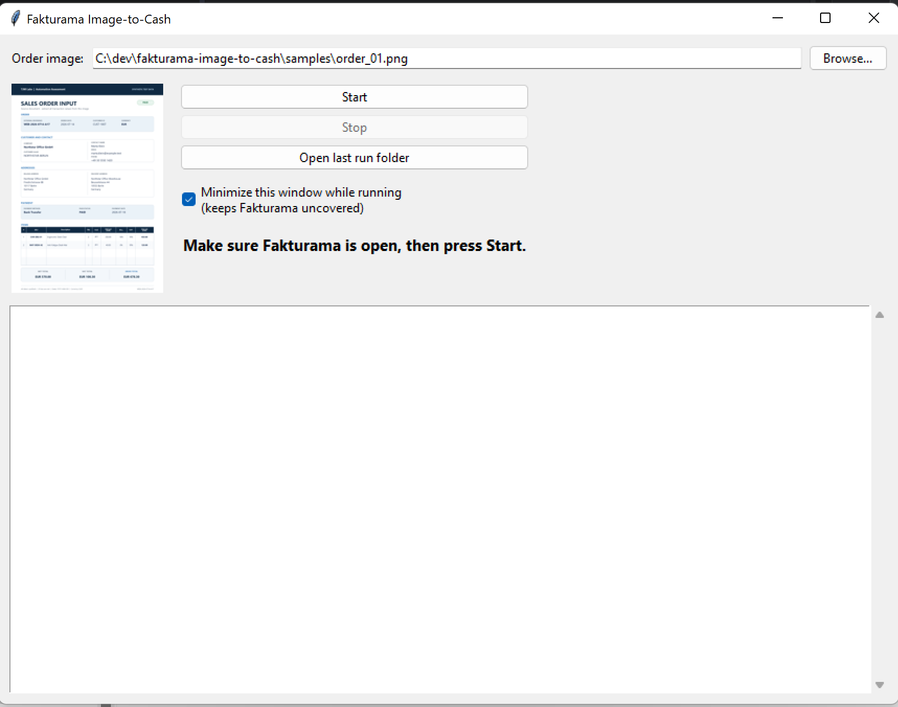

# Fakturama Image-to-Cash

Turns one order image into a saved Fakturama **Order** and its linked **Invoice** (with the payment
status set), verifying every step. The order data is extracted once by an LLM vision call. Fakturama
is then driven through Microsoft UI Automation (pywinauto, UIA backend), with Windows OCR used only
where Fakturama exposes nothing to UIA (its custom-drawn tables and tab labels). There are no
hardcoded screen coordinates. Anything ambiguous or conflicting stops the run for manual review and
leaves Fakturama as it is.

- `DESIGN.md`: the design document (Part 1): architecture, decisions, verification, failure handling, trade-offs.
- `PLAN.md`: the implementation plan the work followed; §14 lists what changed during implementation and why.

## Status

- **The full flow works end to end** against Fakturama 2.x (English UI, Windows 11), in both cases:

  | Case | Run | Result | Time |
  |---|---|---|---|
  | All master data **created** (Debtor with two addresses, payment method, VAT, two products) | `20261108-041316` | PO000018 + INV000013, paid | **128.5 s** |
  | All master data **selected** (same image, run again) | `20261108-041854` | PO000019 + INV000014, paid | **61.6 s** |

  Both ran from a saved extraction (`--from-json`, no LLM call). The first working version took 156 s with
  everything selected and 188 s with everything created; every required check was kept while
  speeding it up (see "What the live runs showed").
- **Create paths were also verified one by one:** stage by stage on an empty database, and again
  after deleting master data by hand (products recreated; "Bank Transfer" recreated for an existing
  Debtor).
- **137 offline tests** (`pytest -q`).
- **LLM used in testing:** Gemini 3.1 Flash-Lite (`LLM_PROVIDER=gemini`). Anthropic Claude Haiku is
  the default in `.env.example`; both use the same schema, validation and cache.

Timing printed at the end of each run (also in `run.log`):

```
  status      : ok  (exit 0)                         status      : ok  (exit 0)
  order       : PO000018    invoice: INV000013       order       : PO000019    invoice: INV000014
  entities    : all created                          entities    : all selected
  prepare     :     4.6 s   (JSON + attach)          prepare     :     4.1 s   (JSON + attach)
  order       :     8.5 s                            order       :     7.8 s
  debtor      :    45.0 s                            debtor      :     6.9 s
  products    :    39.9 s                            products    :    12.7 s
  save_order  :    13.3 s                            save_order  :    12.0 s
  invoice     :    17.2 s                            invoice     :    17.8 s
  TOTAL       :   128.5 s                            TOTAL       :    61.6 s
```

**Evidence of these runs:** the annotated per-step screenshots, `summary.json` and `run.log` are in
`artifacts/20261108-041316/` (created) and `artifacts/20261108-041854/` (selected), 26 screenshots
each. Every run writes to `artifacts/<run-id>/` (`<run-id>` = start time, `YYYYMMDD-HHMMSS`); the
launcher's **Open last run folder** opens the newest one. `artifacts/` is git-ignored.

## Setup

Requirements: Windows 10/11, Fakturama 2.x running with the English UI, Python 3.12, and Windows OCR
for en-US (installed with the English language pack).

```powershell
py -3.12 -m venv .venv
.\.venv\Scripts\Activate.ps1
pip install -e .[dev]
copy .env.example .env   # then set ANTHROPIC_API_KEY, or GEMINI_API_KEY with LLM_PROVIDER=gemini
```

Start Fakturama, maximize it, close any open editor tabs (including the start page, which shows as
"Can't reach this…" when offline), and don't touch mouse or keyboard during a run. Every open
editor makes each UI read slower. The automation must run at the same privilege level as Fakturama.

Run every command below with the venv's Python: activate it first (`.\.venv\Scripts\Activate.ps1`)
or call `.venv\Scripts\python` directly. The system `python` gives `No module named i2c`.

## Usage

**Launcher window:** double-click `Launch.bat` (or run `python -m i2c gui`), pick an order image and
press **Start**.



 It runs the same `python -m i2c run <image>` as below in a subprocess, shows its log
live, minimizes itself during the run so it doesn't cover Fakturama, and shows the result in colour
(done / manual review / error). **Stop** ends the run and leaves Fakturama as it is; **Open last run
folder** opens the newest `artifacts/<run-id>/`.

**Command line:**

```powershell
python -m i2c run samples/order_01.png                  # full flow (extraction cached after the first call)
python -m i2c run --from-json <extracted.json>           # same, without the LLM
python -m i2c extract samples/order_01.png              # extraction only -> artifacts/<run-id>/extracted.json

# development
python -m i2c run --from-json <json> --stop-after order       # run stage by stage
python -m i2c run --from-json <json> --start-at save_order    # continue in the editors already open
python tools/dump_tree.py --window ".*Fakturama.*" --delay 5 --out artifacts/probe/<name>  # UIA probe
python tools/read_table.py --view "VATs" --kind vats          # read one table via UIA rect + OCR
python tools/bench_uia.py                                     # read-only cost of UIA access strategies
python tools/make_samples.py                                  # re-render samples/order_02.png, order_03.png
pytest -q                                                      # 137 offline tests
```

Stages, in order: `order`, `debtor`, `products`, `save_order`, `invoice`.
Exit codes: 0 ok · 2 usage · 3 manual review · 4 error.

**Sample.** `order_01.png` is the brief's image:

| Sample | Debtor | Products / VAT | Payment | Paths it exercises |
|---|---|---|---|---|
| `order_01` | Northstar Office GmbH (two addresses) | CHR-ERG-01, MAT-DESK-02, 19 % | Bank Transfer, PAID | the brief's case |


### What a run produces (evidence)

`artifacts/<run-id>/`:

- `extracted.json` (validated order data) and `run.log`.
- **One annotated screenshot per step**, `NN_<stage>_<step>.png`. A green banner means verified, red
  means stopped; the controls involved are outlined. These screenshots are the evidence deliverable.
- `summary.json`:
  - status (`ok` | `manual_review` | `error`), order and invoice numbers;
  - per entity whether it was **selected or created** (debtor, payment method, each VAT, each product);
  - every step with its verification message, duration, screenshot and cost (UIA calls, OCR passes
    and time spent waiting for Fakturama, as count and seconds), so a slow step can be traced;
  - warnings (e.g. an OCR'd value that was also checked exactly elsewhere);
  - stage durations, total wall-clock time, and `perf` counters (UIA reads, OCR passes, screenshots).

The timing block above is printed and written to `run.log` at the end of every run, including failed ones.

## How it works (details in `DESIGN.md`)

1. **Extract:** one LLM call with a forced JSON tool schema, then deterministic validation (line
   sums, VAT, totals, dates, PAID needs a date). On errors it retries once with the problems listed;
   if it still fails, the run stops for manual review. The result is cached by image hash.
2. **Drive Fakturama:** a runner executes stages of steps. Each step does one action, then
   **verifies** it (read-back via UIA, or OCR for tables), takes a screenshot, and only then
   continues. Every save is clicked once and then verified.
3. **Match deterministically:** debtor, payment method, VAT and product are each `NONE` (create),
   `EXACT` (select), `AMBIGUOUS` or `CONFLICT` (stop for manual review). No LLM is involved.

| Stage | Brief | What it does |
|---|---|---|
| `order` | 1.1–1.8 | New Order; Date, Cust.Ref., Net, With VAT; re-read |
| `debtor` | 2.1–2.13 | search the company; ensure the payment method exists; select or create the Debtor; check the order's addresses |
| `products` | 3.1–3.17 | ensure each VAT rate; per line select or create the product, add it, set Qty/Discount, check the line |
| `save_order` | 4.1–4.7 | check lines, addresses, totals; save once; check Data › Documents; follow-up › Invoice |
| `invoice` | 5.1–5.7 | check what was copied; payment method, paid, date, value; save once; check Documents |

## Decisions on ambiguities in the brief

- **G1** Billing ≠ delivery in the sample, while the brief only covers identical addresses: the
  delivery address becomes a second Debtor address with the Delivery role; its name ("Northstar
  Office Warehouse") goes into that address's "additional name".
- **G2** `CUST-1007` is extracted, but Fakturama's proposed Customer ID is kept.
- **G3** Contact name split: first token = first name, the rest = last name.
- **G4** "Exact" means equal after whitespace/case normalisation.
- **G5** Table rows are read with OCR because NatTable exposes no rows to UIA (confirmed by probe).
- **G6** An existing SKU with a different description is a warning (configurable to stop).
- **The payment method is checked on every run** and created if missing, even when the Debtor
  exists, because the Invoice needs it too. It's handled before any Debtor editor opens, so no
  unsaved editor waits in the background.
- **New products are opened from the top toolbar** ("Create a new product"): the left panel's link
  stopped working once the VATs view had been opened from the left panel (seen live).
- **The unit ("pcs")** is extracted but not entered: Fakturama's item line has no unit field.
- **Documents are found by their number.** The Cust.Ref. shown there is OCR'd and only compared
  loosely (warning), because its exact value is re-read via UIA from the saved editor.

## What the live runs showed (UI layer)

- **Tables are opaque to UIA.** Selector dialogs, Items, Documents, VATs and terms of payment are
  empty `Pane`s. UIA gives the rectangle; OCR runs inside it. Columns come from the grid lines in the
  header; dropped or partly read cells are re-read with the column header pasted in front as context.
- **OCR tolerances never pick silently.** Truncated cells match by visible prefix, item numbers fold
  look-alikes (O/0, I/1), and any match that becomes non-unique is `AMBIGUOUS` and stops the run.
- **Text is typed with real keystrokes, only with proven keyboard focus.** A Company set through UIA
  ValuePattern showed on screen but was saved empty; keys sent without focus once reached the Items
  table. Every value is read back, and saved records are read back from Fakturama's own lists.
- **Dates use arrow keys per field** (text set through UIA reverted to today); the field order is
  learned at run time.
- **SWT tabs can't be selected via UIA**: the tab bar is OCR'd, the label clicked, the switch verified.
- **Selector rows are picked by double-click**; "Select a product" may pick a typed item number by
  itself, which is accepted only if exactly one line for that SKU appears.
- **Safety guards:** no start if an unsaved editor of the same kind is open; no second line for a SKU
  already in the order; a Fakturama dialog during Save stops the run with its text.
- **Speed:** about 75 % of the first runs went into reading the UI tree. Pane-scoped reads, UIA
  `FindFirst`, one cache request per snapshot and background screenshot encoding took the
  all-selected run from 156 s to 61.6 s without dropping a check.
- **Open editors slow everything down.** The first all-created run took 188 s: with five saved
  editors left open, each UIA read cost ~260 ms instead of ~100–150 ms. Saved master-data editors
  (payment method, Debtor, VAT, product) are now closed with Ctrl+F4 right after their save is
  verified: never with unsaved changes, retried if Fakturama ignores the key, and a dialog on
  closing stops the run. Ctrl+W is not bound in Fakturama; it typed a "w" into a saved field.
- **Dialog lookups walked the whole desktop.** Waiting for a selector dialog to open or close
  checked every window on the desktop through UIA, every 0.1 s. Fakturama's own windows are now
  found through Win32 by process id; a new product line went from ~23 s to ~13 s. Together with
  closing editors, the all-created run went from 188 s to 128.5 s.
- **Screenshots are cheap:** 26 per run at ~0.1 s each (about 2 % of a run), so they are always on.

## Skipped / not implemented

- **No resume after a manual-review stop** (see the first item below): a stopped run is finished by
  hand, or re-run after the cause is fixed.
- **No duplicate-order guard:** running the same image twice creates a second Order and Invoice.
- **No scrolling in tables:** only visible rows are read. Searches narrow the lists down, and the
  samples have at most 3 lines.
- **Launching Fakturama** is out of scope (it must be running, English UI, maximized).

## If I had 3 more hours

1. **Continue after a manual-review stop, from the launcher.** When a run stops, the window would
   show the reason prominently and offer "Fix it in Fakturama, then Continue". Continue re-launches
   the run at the stopped stage with the existing `--start-at`, which re-reads the open editors,
   reuses lines already added and never saves a saved document twice. The run must be continued
   after *fixing the cause* (e.g. removing a duplicate Debtor): a step that only paused and let the
   user pick by hand would bypass the verification the brief asks for. The resumed run's folder
   would be linked to the stopped one so the evidence stays together. About 45 min plus a live test.
2. **Duplicate-order guard:** before opening a New Order, search Data › Documents for the external
   reference and stop for manual review if it's already there, so an image can't be invoiced twice.
3. **Live runs of more Orders.**
4. **Table scrolling** for long orders and large lists.
5. **Less OCR in verification:** reopen saved documents and read their fields via UIA, keeping OCR
   for choosing rows only.
6. **OCR-first extraction with LLM fallback**, tests on photographed orders, and CI for the offline
   tests (they already replay real UIA dumps and live OCR captures from `tests/fixtures/`).
